# Jarkom-Modul-3-2026-K-19

## Anggota Kelompok

| Nama | NRP |
| --- | --- |
| Ni Putu Maqueenta Wijaya | 5027251004 |
| Malikha Syafira Dewi | 5027251032 |

## Pembahasan
## Soal 1 — Konfigurasi jaringan dan routing

Jichi berperan sebagai router yang menghubungkan jaringan `10.73.1.0/24`, `10.73.2.0/24`, `10.73.3.0/24`, dan `10.73.4.0/24`. Antarmuka internal diberi alamat gateway `.1` pada masing-masing subnet, sedangkan node lain dikonfigurasi menggunakan alamat statis sesuai jaringannya. Pada Jichi, IP forwarding diaktifkan dan NAT `MASQUERADE` dipasang pada antarmuka yang mengarah ke jaringan luar. Dengan begitu, node-node pada jaringan internal dapat meneruskan lalu lintas melalui router.

Pengujian ping pada beberapa node menunjukkan bahwa koneksi antarnode dan gateway dapat dijangkau.

**Jichi — router**

```bash
auto eth0 eth1 eth2 eth3 eth4

iface eth0 inet dhcp

iface eth1 inet static
    address 10.73.1.1
    netmask 255.255.255.0

iface eth2 inet static
    address 10.73.2.1
    netmask 255.255.255.0

iface eth3 inet static
    address 10.73.3.1
    netmask 255.255.255.0

iface eth4 inet static
    address 10.73.4.1
    netmask 255.255.255.0

echo "nameserver 192.168.122.1" > /etc/resolv.conf

ifup eth1 eth2 eth3 eth4 2>/dev/null || (ip addr add 10.73.1.1/24 dev eth1; ip addr add 10.73.2.1/24 dev eth2; ip addr add 10.73.3.1/24 dev eth3; ip addr add 10.73.4.1/24 dev eth4)

sysctl -w net.ipv4.ip_forward=1
echo "net.ipv4.ip_forward=1" > /etc/sysctl.conf
iptables -t nat -F
iptables -t nat -A POSTROUTING -o eth0 -j MASQUERADE

ip addr add 192.168.122.100/24 dev eth0 2>/dev/null
ip link set eth0 up
ip route add default via 192.168.122.1 2>/dev/null
```

**Utahime — `10.73.1.2/24`**

```bash
auto eth0

iface eth0 inet static
    address 10.73.1.2
    netmask 255.255.255.0
    gateway 10.73.1.1

echo "nameserver 192.168.122.1" > /etc/resolv.conf
service networking restart
```

**Shoko — `10.73.1.3/24`**

```bash
auto eth0

iface eth0 inet static
    address 10.73.1.3
    netmask 255.255.255.0
    gateway 10.73.1.1

echo "nameserver 192.168.122.1" > /etc/resolv.conf
service networking restart
```

**Gojo — `10.73.1.4/24`**

```bash
auto eth0

iface eth0 inet static
    address 10.73.1.4
    netmask 255.255.255.0
    gateway 10.73.1.1

echo "nameserver 192.168.122.1" > /etc/resolv.conf
service networking restart
```

**Itadori, Fushiguro, Zenin, dan Okkotsu — klien DHCP Network 2**

```bash
auto eth0

iface eth0 inet dhcp
echo "nameserver 192.168.122.1" > /etc/resolv.conf
service networking restart
```

**Ino, Kusakabe, Kugisaki, dan Miwa — klien DHCP Network 3**

```bash
auto eth0

iface eth0 inet dhcp
echo "nameserver 192.168.122.1" > /etc/resolv.conf
service networking restart
```

**Geto — `10.73.4.2/24`**

```bash
auto eth0

iface eth0 inet static
    address 10.73.4.2
    netmask 255.255.255.0
    gateway 10.73.4.1

echo "nameserver 192.168.122.1" > /etc/resolv.conf
service networking restart
```

**Maki — `10.73.4.3/24`**

```bash
auto eth0

iface eth0 inet static
    address 10.73.4.3
    netmask 255.255.255.0
    gateway 10.73.4.1

echo "nameserver 192.168.122.1" > /etc/resolv.conf
service networking restart
```

**Panda — `10.73.4.4/24`**

```bash
auto eth0

iface eth0 inet static
    address 10.73.4.4
    netmask 255.255.255.0
    gateway 10.73.4.1

echo "nameserver 192.168.122.1" > /etc/resolv.conf
service networking restart
```

**Nanami — `10.73.4.5/24`**

```bash
auto eth0

iface eth0 inet static
    address 10.73.4.5
    netmask 255.255.255.0
    gateway 10.73.4.1

echo "nameserver 192.168.122.1" > /etc/resolv.conf
service networking restart
```

**Todo — `10.73.4.6/24`**

```bash
auto eth0

iface eth0 inet static
    address 10.73.4.6
    netmask 255.255.255.0
    gateway 10.73.4.1

echo "nameserver 192.168.122.1" > /etc/resolv.conf
service networking restart
```

**Kirara — `10.73.4.7/24`**

```bash
auto eth0

iface eth0 inet static
    address 10.73.4.7
    netmask 255.255.255.0
    gateway 10.73.4.1

echo "nameserver 192.168.122.1" > /etc/resolv.conf
service networking restart
```

**Tengen — `10.73.4.8/24`**

```bash
auto eth0

iface eth0 inet static
    address 10.73.4.8
    netmask 255.255.255.0
    gateway 10.73.4.1

echo "nameserver 192.168.122.1" > /etc/resolv.conf
service networking restart
```

**Yaga — `10.73.4.9/24`**

```bash
auto eth0

iface eth0 inet static
    address 10.73.4.9
    netmask 255.255.255.0
    gateway 10.73.4.1

echo "nameserver 192.168.122.1" > /etc/resolv.conf
service networking restart
```

**Inumaki — `10.73.4.10/24`**

```bash
auto eth0

iface eth0 inet static
    address 10.73.4.10
    netmask 255.255.255.0
    gateway 10.73.4.1

echo "nameserver 192.168.122.1" > /etc/resolv.conf
service networking restart
```

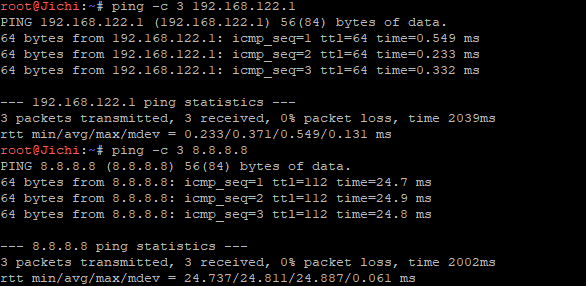
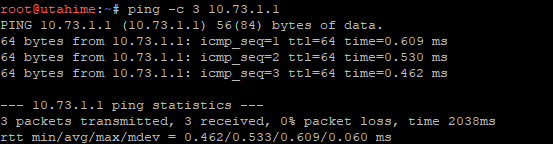
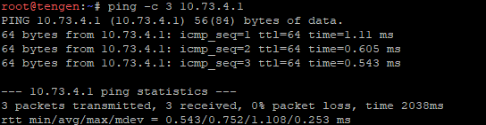
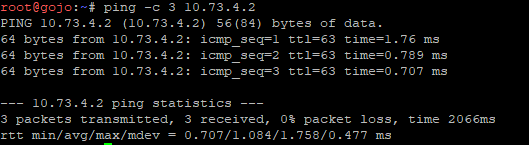

## Soal 2 — Konfigurasi DHCP server

Di Tengen dipasang layanan `isc-dhcp-server` dan antarmuka layanan ditetapkan ke `eth0`. Konfigurasi awal menyediakan pool untuk Network 2 (`10.73.2.2–10.73.2.254`) dan Network 3 (`10.73.3.2–10.73.3.254`), dengan gateway masing-masing `.2.1` dan `.3.1`, serta DNS `10.73.1.2` dan `10.73.1.3`. Sebelum instalasi, koneksi keluar diuji agar repositori paket dapat diakses; ping pada tangkapan layar menunjukkan gateway luar dan alamat publik merespons.

**Tengen — instalasi dan konfigurasi DHCP server**

```bash
#!/bin/sh

# Set nameserver sementara untuk download paket
echo "nameserver 192.168.122.1" > /etc/resolv.conf

# Update repository dan install isc-dhcp-server
apt-get update && apt-get install -y isc-dhcp-server

# Konfigurasi interface isc-dhcp-server
cat << 'EOF' > /etc/default/isc-dhcp-server
INTERFACESv4="eth0"
INTERFACESv6=""
EOF

# Konfigurasi /etc/dhcp/dhcpd.conf
cat << 'EOF' > /etc/dhcp/dhcpd.conf
default-lease-time 600;
max-lease-time 7200;
authoritative;

# 1. Subnet lokal Network 4 (Tanpa Pool Dinamis agar tidak error "No subnet declaration")
subnet 10.73.4.0 netmask 255.255.255.0 {
}

# 2. Scope Network 2 (Divisi A)
subnet 10.73.2.0 netmask 255.255.255.0 {
    range 10.73.2.2 10.73.2.254;
    option routers 10.73.2.1;
    option domain-name-servers 10.73.1.2, 10.73.1.3;
    default-lease-time 3600;
    max-lease-time 7200;
}

# 3. Scope Network 3 (Divisi B)
subnet 10.73.3.0 netmask 255.255.255.0 {
    range 10.73.3.2 10.73.3.254;
    option routers 10.73.3.1;
    option domain-name-servers 10.73.1.2, 10.73.1.3;
    default-lease-time 3600;
    max-lease-time 7200;
}
EOF

# Validasi sintaks konfigurasi
dhcpd -t -cf /etc/dhcp/dhcpd.conf

# Restart dan pastikan service berjalan
service isc-dhcp-server restart || /etc/init.d/isc-dhcp-server restart
```

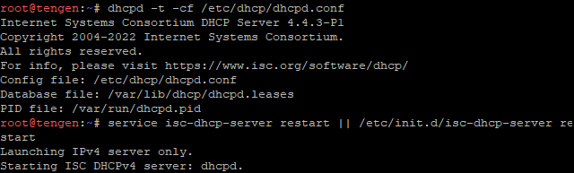

## Soal 3 — Konfigurasi DHCP relay

DHCP relay dipasang pada Jichi agar permintaan DHCP dari jaringan yang berbeda dapat diteruskan ke Tengen di `10.73.4.8`. Relay dikonfigurasi untuk mendengarkan antarmuka `eth2`, `eth3`, dan `eth4`, lalu permintaan alamat diuji dari klien menggunakan `udhcpc`.

Tangkapan layar berikut merupakan pengujian konektivitas pada jaringan yang digunakan dalam konfigurasi, bukan output langsung dari proses DHCP relay.

**Jichi — instalasi dan konfigurasi DHCP relay**

```bash
#!/bin/sh

# Set Temporary Nameserver untuk download paket
echo "nameserver 192.168.122.1" > /etc/resolv.conf

# Install isc-dhcp-relay
apt-get update && apt-get install -y isc-dhcp-relay

# Konfigurasi /etc/default/isc-dhcp-relay
cat << 'EOF' > /etc/default/isc-dhcp-relay
SERVERS="10.73.4.8"
INTERFACES="eth2 eth3 eth4"
OPTIONS=""
EOF

# Restart Service DHCP Relay
service isc-dhcp-relay restart || /etc/init.d/isc-dhcp-relay restart
```

**Itadori — meminta alamat melalui DHCP**

```bash
# Set DNS sementara (ke NAT1 / Google)
echo "nameserver 192.168.122.1" > /etc/resolv.conf

# Testing
udhcpc -i eth0
```

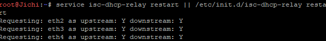
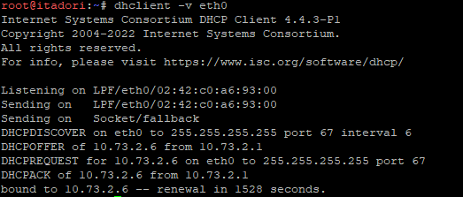

## Soal 4 — Pembagian alamat DHCP berdasarkan kelas klien

Konfigurasi DHCP membagi klien Network 2 ke dalam dua kelas berdasarkan alamat MAC. Klien Dev Team memperoleh alamat dari rentang `10.73.2.10–10.73.2.35`, sedangkan Support Team memperoleh alamat dari rentang `10.73.2.70–10.73.2.95`. Setelah konfigurasi diterapkan, layanan DHCP direstart dan klien meminta alamat melalui `udhcpc`.

**Tengen — kelas klien dan konfigurasi pool DHCP**

```bash
cat << 'EOF' > /etc/dhcp/dhcpd.conf
default-lease-time 600;
max-lease-time 7200;
authoritative;

# ==========================================
# KELAS NETWORK 2 (DIVISI A) - SOAL 4 (MAC TERBARU)
# ==========================================
# Dev Team: itadori & fushiguro
class "dev-team" {
    match if hardware = 1:02:42:d6:17:eb:00 or
             hardware = 1:02:42:58:7f:b4:00;
}

class "support-team" {
    match if hardware = 1:02:42:0c:74:7a:00 or
             hardware = 1:02:42:80:05:e5:00;
}

# ==========================================
# KELAS NETWORK 3 (DIVISI B) - SOAL 5
# ==========================================
class "short-lease-clients" {
    match if hardware = 1:02:42:53:99:4e:00 or
             hardware = 1:02:42:82:1f:d5:00;
}

class "long-lease-clients" {
    match if hardware = 1:02:42:18:10:54:00;
}

# ==========================================
# STATIC LEASE (RESERVASI IP VIP) - SOAL 6
# ==========================================
host kugisaki {
    hardware ethernet f2:dd:ec:51:c9:cb;
    fixed-address 10.73.3.99;
}

# ==========================================
# SUBNET DEFINITIONS & OPTIONS - SOAL 7
# ==========================================
subnet 10.73.4.0 netmask 255.255.255.0 {
}

# Subnet Network 2 (Divisi A)
subnet 10.73.2.0 netmask 255.255.255.0 {
    option subnet-mask 255.255.255.0;
    option broadcast-address 10.73.2.255;
    option routers 10.73.2.1;
    option domain-name-servers 10.73.1.2, 10.73.1.3;
    option domain-name "jujutsu.com";
    option domain-search "jujutsu.com";

    # Pool 1: Dev Team (10.73.2.10 - 10.73.2.35)
    pool {
        allow members of "dev-team";
        range 10.73.2.10 10.73.2.35;
    }

    # Pool 2: Support Team (10.73.2.70 - 10.73.2.95)
    pool {
        allow members of "support-team";
        range 10.73.2.70 10.73.2.95;
    }
}

# Subnet Network 3 (Divisi B)
subnet 10.73.3.0 netmask 255.255.255.0 {
    option subnet-mask 255.255.255.0;
    option broadcast-address 10.73.3.255;
    option routers 10.73.3.1;
    option domain-name-servers 10.73.1.2, 10.73.1.3;
    option domain-name "jujutsu.com";
    option domain-search "jujutsu.com";

    # Pool Short Lease (1800s / 30m)
    pool {
        allow members of "short-lease-clients";
        range 10.73.3.10 10.73.3.89;
        default-lease-time 1800;
        max-lease-time 1800;
    }

    # Pool Long Lease (43200s / 12j)
    pool {
        allow members of "long-lease-clients";
        range 10.73.3.100 10.73.3.199;
        default-lease-time 43200;
        max-lease-time 43200;
    }
}
EOF

# Validasi sintaks dan restart service
dhcpd -t -cf /etc/dhcp/dhcpd.conf
service isc-dhcp-server restart || /etc/init.d/isc-dhcp-server restart
```

**Itadori dan Fushiguro — klien kelas Dev Team**

```bash
udhcpc -i eth0
```

**Zenin dan Okkotsu — klien kelas Support Team**

```bash
udhcpc -i eth0
```


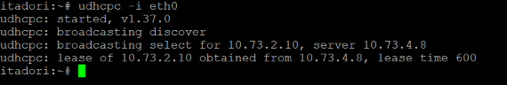
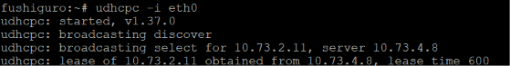
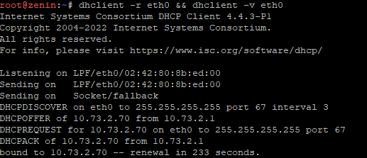
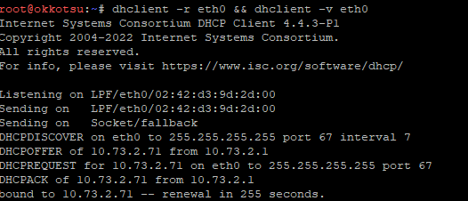

## Soal 5 — Pengaturan durasi lease

Pada Network 3, kelas klien digunakan untuk membedakan rentang alamat dan lama lease. Klien dengan lease pendek mendapat alamat dari `10.73.3.10–10.73.3.89` dengan durasi 1.800 detik (30 menit). Klien dengan lease panjang mendapat alamat dari `10.73.3.100–10.73.3.199` dengan durasi 43.200 detik (12 jam). Nilai durasi tersebut ditetapkan sebagai `default-lease-time` dan `max-lease-time` pada masing-masing pool.

**Tengen — kelas klien dan lease Network 3**

```bash
cat << 'EOF' > /etc/dhcp/dhcpd.conf
default-lease-time 600;
max-lease-time 7200;
authoritative;

class "dev-team" {
    match if hardware = 1:02:42:d6:17:eb:00 or
             hardware = 1:02:42:58:7f:b4:00;
}

class "support-team" {
    match if hardware = 1:02:42:0c:74:7a:00 or
             hardware = 1:02:42:80:05:e5:00;
}

class "short-lease-clients" {
    match if hardware = 1:02:42:87:5f:a1:00 or
             hardware = 1:02:42:61:7e:7f:00;
}

class "long-lease-clients" {
    match if hardware = 1:02:42:ac:34:54:00;
}

host kugisaki {
    hardware ethernet f2:dd:ec:51:c9:cb;
    fixed-address 10.73.3.99;
}

subnet 10.73.4.0 netmask 255.255.255.0 {
}

subnet 10.73.2.0 netmask 255.255.255.0 {
    option subnet-mask 255.255.255.0;
    option broadcast-address 10.73.2.255;
    option routers 10.73.2.1;
    option domain-name-servers 10.73.1.2, 10.73.1.3;
    option domain-search "jujutsu.com";

    pool {
        allow members of "dev-team";
        range 10.73.2.10 10.73.2.35;
    }

    pool {
        allow members of "support-team";
        range 10.73.2.70 10.73.2.95;
    }
}

subnet 10.73.3.0 netmask 255.255.255.0 {
    option subnet-mask 255.255.255.0;
    option broadcast-address 10.73.3.255;
    option routers 10.73.3.1;
    option domain-name-servers 10.73.1.2, 10.73.1.3;
    option domain-search "jujutsu.com";

    pool {
        allow members of "short-lease-clients";
        range 10.73.3.10 10.73.3.89;
        default-lease-time 1800;
        max-lease-time 1800;
    }

    pool {
        allow members of "long-lease-clients";
        range 10.73.3.100 10.73.3.199;
        default-lease-time 43200;
        max-lease-time 43200;
    }
}
EOF

service isc-dhcp-server restart || /etc/init.d/isc-dhcp-server restart
```

**Ino, Kusakabe, dan Miwa — meminta lease dari DHCP**

```bash
udhcpc -i eth0
```

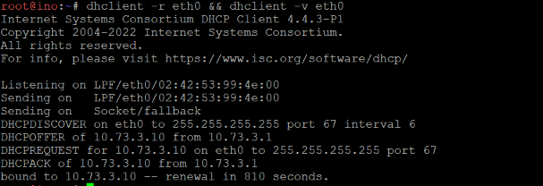
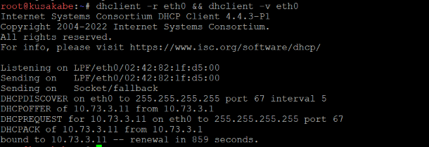
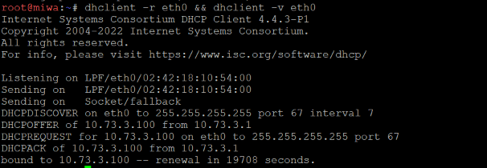

## Soal 6 — Reservasi alamat untuk Kugisaki

Reservasi DHCP yang didefinisikan pada konfigurasi server mengikat alamat MAC Kugisaki ke alamat `10.73.3.99`. Kugisaki meminta konfigurasi melalui `udhcpc`, lalu alamat pada antarmuka, rute default, dan DNS diperiksa. Hasilnya menunjukkan bahwa klien menerima alamat reservasi beserta parameter jaringan dari server.

**Tengen — konfigurasi DHCP dengan reservasi Kugisaki**

```bash
cat << 'EOF' > /etc/dhcp/dhcpd.conf
default-lease-time 600;
max-lease-time 7200;
authoritative;

class "dev-team" {
    match if hardware = 1:02:42:d6:17:eb:00 or
             hardware = 1:02:42:58:7f:b4:00;
}

class "support-team" {
    match if hardware = 1:02:42:0c:74:7a:00 or
             hardware = 1:02:42:80:05:e5:00;
}

class "short-lease-clients" {
    match if hardware = 1:02:42:87:5f:a1:00 or
             hardware = 1:02:42:61:7e:7f:00;
}

class "long-lease-clients" {
    match if hardware = 1:02:42:ac:34:54:00;
}

host kugisaki {
    hardware ethernet 02:42:c4:b9:32:00;
    fixed-address 10.73.3.99;
}

subnet 10.73.4.0 netmask 255.255.255.0 {
}

subnet 10.73.2.0 netmask 255.255.255.0 {
    option subnet-mask 255.255.255.0;
    option broadcast-address 10.73.2.255;
    option routers 10.73.2.1;
    option domain-name-servers 10.73.1.2, 10.73.1.3;
    option domain-search "jujutsu.com";

    pool {
        allow members of "dev-team";
        range 10.73.2.10 10.73.2.35;
    }

    pool {
        allow members of "support-team";
        range 10.73.2.70 10.73.2.95;
    }
}

subnet 10.73.3.0 netmask 255.255.255.0 {
    option subnet-mask 255.255.255.0;
    option broadcast-address 10.73.3.255;
    option routers 10.73.3.1;
    option domain-name-servers 10.73.1.2, 10.73.1.3;
    option domain-search "jujutsu.com";

    pool {
        allow members of "short-lease-clients";
        range 10.73.3.10 10.73.3.89;
        default-lease-time 1800;
        max-lease-time 1800;
    }

    pool {
        allow members of "long-lease-clients";
        range 10.73.3.100 10.73.3.199;
        default-lease-time 43200;
        max-lease-time 43200;
    }
}
EOF

# Validasi sintaks dan restart layanan DHCP
dhcpd -t -cf /etc/dhcp/dhcpd.conf
service isc-dhcp-server restart || /etc/init.d/isc-dhcp-server restart
```

**Kugisaki — meminta alamat reservasi**

```bash
udhcpc -i eth0
```

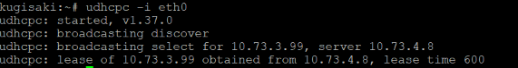

## Soal 7 — Verifikasi parameter DHCP dan lease klien

Selain alamat IP, server memberikan subnet mask `/24`, alamat broadcast, default gateway, DNS `10.73.1.2` dan `10.73.1.3`, serta domain pencarian `jujutsu.com`. Pengaturan ini diterapkan pada subnet Network 2 dan Network 3. Konfigurasi klien diperiksa menggunakan `ip a`, `ip route`, dan `/etc/resolv.conf`; catatan lease pada Tengen juga diperiksa untuk memastikan alamat telah terikat pada klien.

**Tengen — konfigurasi DHCP, verifikasi lease**

```bash
cat << 'EOF' > /etc/dhcp/dhcpd.conf
default-lease-time 600;
max-lease-time 7200;
authoritative;

class "dev-team" {
    match if hardware = 1:02:42:d6:17:eb:00 or
             hardware = 1:02:42:58:7f:b4:00;
}

class "support-team" {
    match if hardware = 1:02:42:0c:74:7a:00 or
             hardware = 1:02:42:80:05:e5:00;
}

class "short-lease-clients" {
    match if hardware = 1:02:42:87:5f:a1:00 or
             hardware = 1:02:42:61:7e:7f:00;
}

class "long-lease-clients" {
    match if hardware = 1:02:42:ac:34:54:00;
}

host kugisaki {
    hardware ethernet 02:42:c4:b9:32:00;
    fixed-address 10.73.3.99;
}

subnet 10.73.4.0 netmask 255.255.255.0 {
}

subnet 10.73.2.0 netmask 255.255.255.0 {
    option subnet-mask 255.255.255.0;
    option broadcast-address 10.73.2.255;
    option routers 10.73.2.1;
    option domain-name-servers 10.73.1.2, 10.73.1.3;
    option domain-name "jujutsu.com";
    option domain-search "jujutsu.com";

    pool {
        allow members of "dev-team";
        range 10.73.2.10 10.73.2.35;
    }

    pool {
        allow members of "support-team";
        range 10.73.2.70 10.73.2.95;
    }
}

subnet 10.73.3.0 netmask 255.255.255.0 {
    option subnet-mask 255.255.255.0;
    option broadcast-address 10.73.3.255;
    option routers 10.73.3.1;
    option domain-name-servers 10.73.1.2, 10.73.1.3;
    option domain-name "jujutsu.com";
    option domain-search "jujutsu.com";

    pool {
        allow members of "short-lease-clients";
        range 10.73.3.10 10.73.3.89;
        default-lease-time 1800;
        max-lease-time 1800;
    }

    pool {
        allow members of "long-lease-clients";
        range 10.73.3.100 10.73.3.199;
        default-lease-time 43200;
        max-lease-time 43200;
    }
}
EOF

service isc-dhcp-server restart || /etc/init.d/isc-dhcp-server restart

# Periksa lease yang tercatat pada server
cat /var/lib/dhcp/dhcpd.leases
grep -E "lease|hardware ethernet|binding state" /var/lib/dhcp/dhcpd.leases
```

**Klien Network 2 dan Network 3 — meminta IP dan memeriksa konfigurasi**

```bash
udhcpc -i eth0
ip a show eth0
ip route
cat /etc/resolv.conf
```

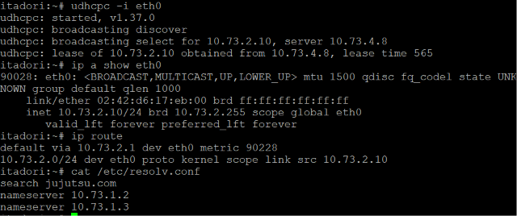
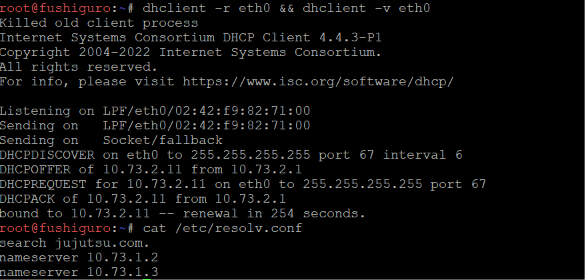
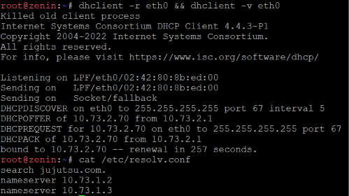
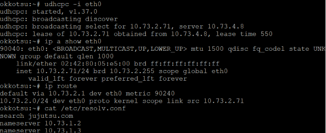
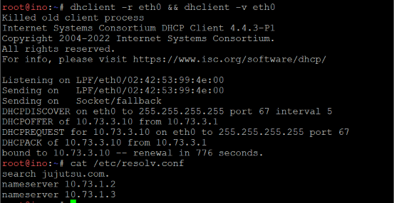
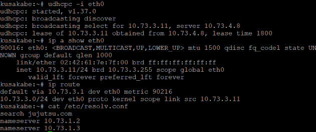
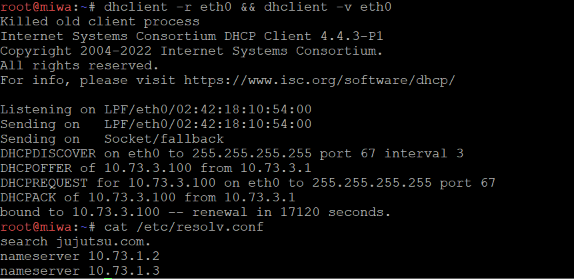
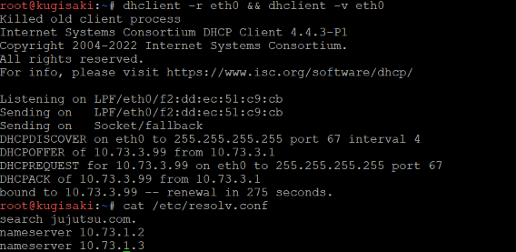
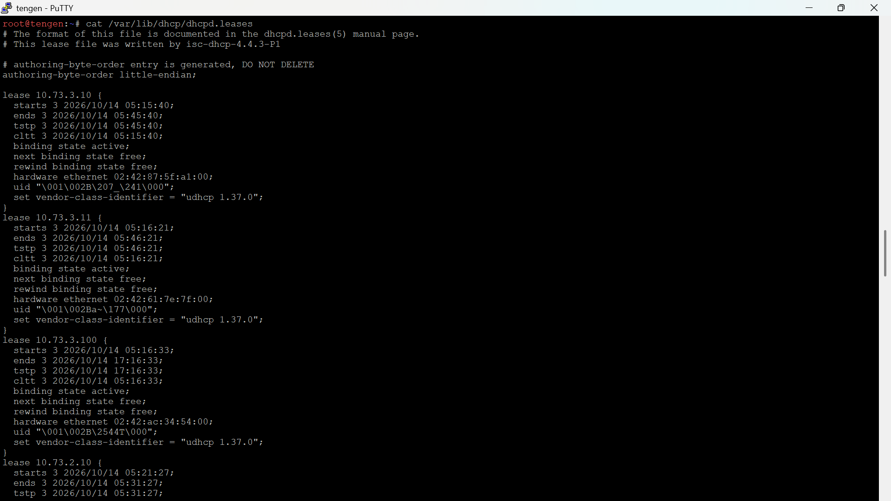
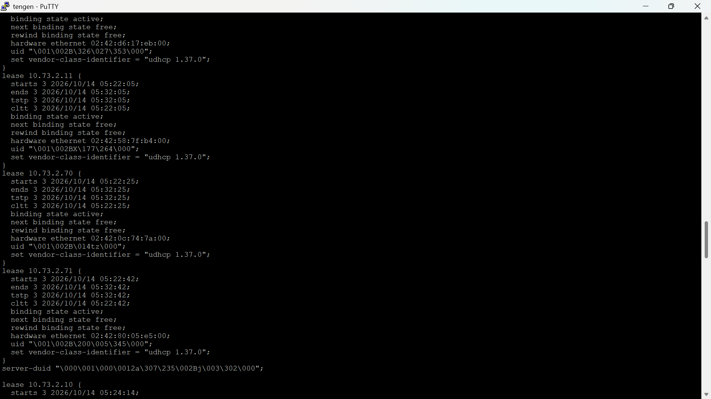
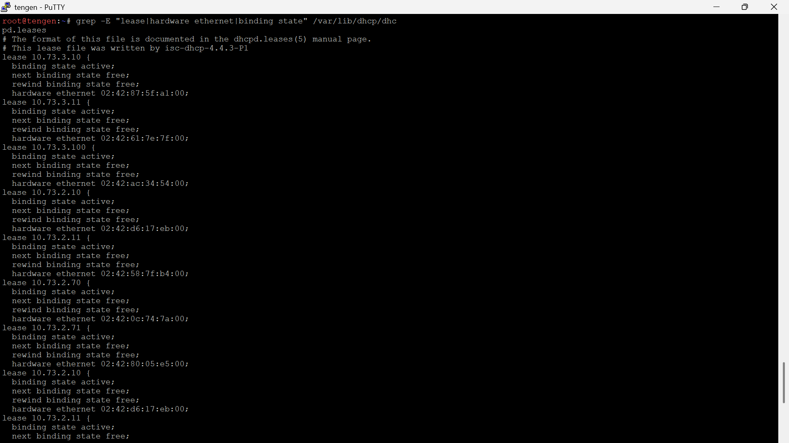

## Soal 8 — Pengujian DHCP relay

Layanan DHCP relay pada Jichi dihentikan dan dijalankan kembali. Setelah relay aktif, klien di Network 2 meminta alamat menggunakan `udhcpc`. Klien memperoleh lease dari Tengen melalui relay, yang menunjukkan bahwa permintaan lintas subnet dapat diteruskan.

**Tengen — menangkap paket DHCP**

```bash
tcpdump -i eth0 -nvv "port 67 or port 68"
```

**Itadori — meminta lease dengan mode gagal cepat**

```bash
udhcpc -i eth0 -n -q
```

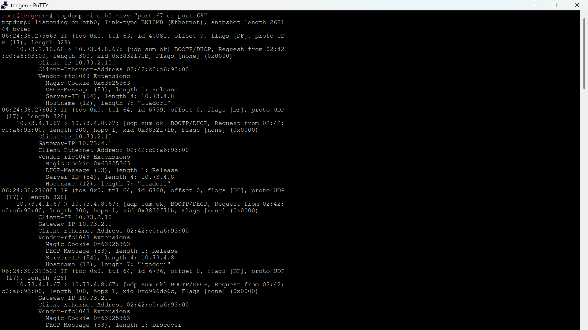

## Soal 9 — Restart DHCP server dan relay

Layanan DHCP server di Tengen dan DHCP relay di Jichi direstart, kemudian masing-masing dihentikan dan dijalankan kembali. Klien meminta lease setelah layanan aktif. Catatan lease di server turut diperiksa untuk melihat alamat yang telah diberikan.

**Jichi — hentikan lalu jalankan DHCP relay**

```bash
# Matikan relay
service isc-dhcp-relay stop || /etc/init.d/isc-dhcp-relay stop

# Nyalakan kembali relay
service isc-dhcp-relay start || /etc/init.d/isc-dhcp-relay start
```

**Itadori — uji permintaan DHCP**

```bash
udhcpc -i eth0 -n -q
```

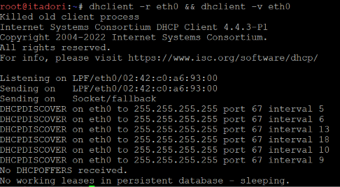
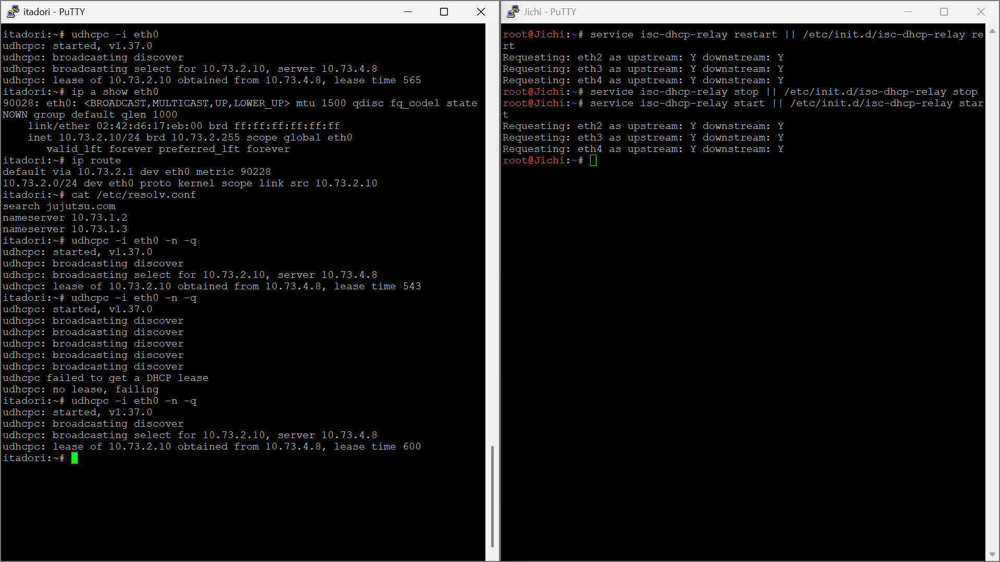

## Soal 10 — Validasi permintaan DHCP setelah restart

Pengujian diulangi dengan merestart DHCP server dan relay, lalu menghentikan dan menjalankan kembali kedua layanan. Setelah itu klien meminta lease melalui `udhcpc`. Tangkapan layar digunakan untuk memeriksa bahwa layanan kembali berjalan dan respons DHCP diterima oleh klien.

**Tengen — restart DHCP server**

```bash
service isc-dhcp-server restart || /etc/init.d/isc-dhcp-server restart
service isc-dhcp-server stop && service isc-dhcp-server start
```

**Jichi — restart DHCP relay**

```bash
service isc-dhcp-relay restart || /etc/init.d/isc-dhcp-relay restart
service isc-dhcp-relay stop && service isc-dhcp-relay start
```

**Itadori — uji permintaan DHCP**

```bash
udhcpc -i eth0 -n -q
```

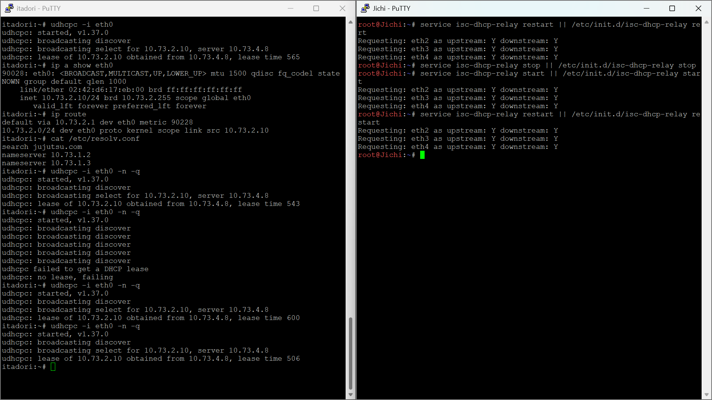
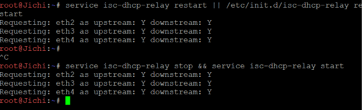

## Soal 11 — Konfigurasi routing Jichi dan DNS Master-Slave

Jichi dikonfigurasi sebagai gateway Network 1 dan Network 2 dengan IP forwarding aktif, serta NAT agar Utahime dan Shoko dapat mengunduh paket melalui Jichi. Utahime disiapkan sebagai DNS Master dan Shoko sebagai DNS Slave untuk zona `jujutsu.com`. Itadori sebagai klien menguji konektivitas ke gateway dan kedua DNS server, lalu melakukan query SOA ke Master dan Slave untuk memastikan zona sudah tersinkron.

**Jichi — konfigurasi interface, forwarding, dan NAT**

```bash
ip link set eth0 up
ip link set eth2 up
ip addr replace 10.73.1.1/24 dev eth0
ip addr replace 10.73.2.1/24 dev eth2
sysctl -w net.ipv4.ip_forward=1

# NAT supaya utahime/shoko bisa apt-get lewat Jichi (eth1 = sisi NAT/internet)
iptables -t nat -C POSTROUTING -o eth1 -j MASQUERADE 2>/dev/null || \
iptables -t nat -A POSTROUTING -o eth1 -j MASQUERADE

ip a
ip route
```

**Utahime — DNS Master**

```bash
ip link set eth0 up
ip addr replace 10.73.1.2/24 dev eth0
ip route replace default via 10.73.1.1
echo "nameserver 8.8.8.8" > /etc/resolv.conf

# cek konektivitas dulu sebelum install
ping -c 2 10.73.1.1 || echo "GAGAL: gateway Jichi belum aktif"

apt-get update && apt-get install -y bind9 bind9utils bind9-dnsutils dnsutils

mkdir -p /etc/bind/jujutsu

cat << 'EOF' > /etc/bind/named.conf.options
options {
        directory "/var/cache/bind";
        forwarders {
                192.168.122.1;
                8.8.8.8;
        };
        allow-query { any; };
        auth-nxdomain no;
        listen-on-v6 { any; };
};
EOF

cat << 'EOF' > /etc/bind/named.conf.local
zone "jujutsu.com" {
    type master;
    file "/etc/bind/jujutsu/jujutsu.com";
    allow-transfer { 10.73.1.3; };
    also-notify { 10.73.1.3; };
};
EOF

cat << 'EOF' > /etc/bind/jujutsu/jujutsu.com
$TTL    604800
@       IN      SOA     utahime.jujutsu.com. admin.jujutsu.com. (
                              2026101301 ; Serial
                                  604800 ; Refresh
                                   86400 ; Retry
                                 2419200 ; Expire
                                  604800 ) ; Negative Cache TTL
;
@       IN      NS      utahime.jujutsu.com.
@       IN      NS      shoko.jujutsu.com.

utahime IN      A       10.73.1.2
shoko   IN      A       10.73.1.3
@       IN      A       10.73.1.2
EOF

named-checkconf
named-checkzone jujutsu.com /etc/bind/jujutsu/jujutsu.com
service named restart || service bind9 restart
```

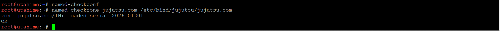

**Shoko — DNS Slave**

```bash
ip link set eth0 up
ip addr replace 10.73.1.3/24 dev eth0
ip route replace default via 10.73.1.1
echo "nameserver 8.8.8.8" > /etc/resolv.conf

ping -c 2 10.73.1.1 || echo "GAGAL: gateway Jichi belum aktif"

apt-get update && apt-get install -y bind9 bind9utils bind9-dnsutils dnsutils

mkdir -p /etc/bind

cat << 'EOF' > /etc/bind/named.conf.options
options {
        directory "/var/cache/bind";
        forwarders {
                192.168.122.1;
                8.8.8.8;
        };
        allow-query { any; };
        auth-nxdomain no;
        listen-on-v6 { any; };
};
EOF

cat << 'EOF' > /etc/bind/named.conf.local
zone "jujutsu.com" {
    type slave;
    masters { 10.73.1.2; };
    file "/var/lib/bind/jujutsu.com";
};
EOF

named-checkconf
ls -la /var/lib/bind/
service named restart || service bind9 restart
```

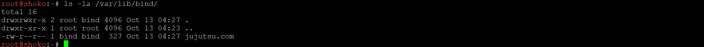

**Itadori — konfigurasi klien dan uji konektivitas**

```bash
ip link set eth0 up
ip addr replace 10.73.2.2/24 dev eth0
ip route replace default via 10.73.2.1
ip a
ip route
ping -c 2 10.73.2.1
ping -c 2 10.73.1.2
ping -c 2 10.73.1.3
```

**Itadori — uji query DNS**

```bash
dig @10.73.1.2 jujutsu.com SOA
dig @10.73.1.3 jujutsu.com SOA
```

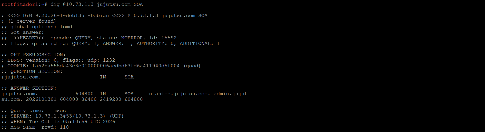

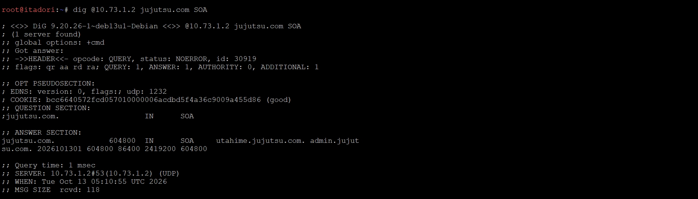

## Soal 12 — Record A, CNAME, dan Reverse DNS (PTR) pada DNS Master-Slave

Zona `jujutsu.com` pada Utahime diperbarui dengan record A untuk Gojo, record CNAME `www` yang merujuk ke domain utama, serta zona reverse `1.73.10.in-addr.arpa` untuk pemetaan PTR. DNS Forwarder diarahkan ke gateway internet `192.168.122.1`. Shoko sebagai Slave menerima transfer kedua zona dari Master. Itadori sebagai klien menguji record CNAME, A, dan PTR dengan `dig`, serta membuktikan bahwa domain internet tetap dapat dijangkau.

**Utahime — konfigurasi forwarder, zona forward, dan zona reverse**

```bash
# 1. Update Konfigurasi Named Options (Forwarder & DNSSEC)
cat << 'EOF' > /etc/bind/named.conf.options
options {
        directory "/var/cache/bind";
        forwarders {
                192.168.122.1;
        };
        allow-query { any; };
        auth-nxdomain no;    # conform to RFC1035
        listen-on-v6 { any; };
        dnssec-validation no;
};
EOF

# 2. Update Konfigurasi Named Local (Tambah Zone Reverse PTR)
cat << 'EOF' > /etc/bind/named.conf.local
zone "jujutsu.com" {
    type master;
    file "/etc/bind/jujutsu/jujutsu.com";
    allow-transfer { 10.73.1.3; };
    also-notify { 10.73.1.3; };
};

zone "1.73.10.in-addr.arpa" {
    type master;
    file "/etc/bind/jujutsu/1.73.10.in-addr.arpa";
    allow-transfer { 10.73.1.3; };
    also-notify { 10.73.1.3; };
};
EOF

# 3. Update Zone File Forward jujutsu.com (A Record Gojo & CNAME www)
cat << 'EOF' > /etc/bind/jujutsu/jujutsu.com
$TTL    604800
@       IN      SOA     utahime.jujutsu.com. admin.jujutsu.com. (
                              2026101303 ; Serial dinaikkan
                                  604800 ; Refresh
                                   86400 ; Retry
                                 2419200 ; Expire
                                  604800 ) ; Negative Cache TTL
;
; Name Servers
@       IN      NS      utahime.jujutsu.com.
@       IN      NS      shoko.jujutsu.com.

; A Records Name Servers & Domain Utama (A Record Gojo)
utahime IN      A       10.73.1.2
shoko   IN      A       10.73.1.3
gojo    IN      A       10.73.1.4
@       IN      A       10.73.1.4

; CNAME Record www
www     IN      CNAME   jujutsu.com.
EOF

# 4. Buat Reverse Zone File (1.73.10.in-addr.arpa)
cat << 'EOF' > /etc/bind/jujutsu/1.73.10.in-addr.arpa
$TTL    604800
@       IN      SOA     utahime.jujutsu.com. admin.jujutsu.com. (
                              2026101301 ; Serial
                                  604800 ; Refresh
                                   86400 ; Retry
                                 2419200 ; Expire
                                  604800 ) ; Negative Cache TTL
;
@       IN      NS      utahime.jujutsu.com.
@       IN      NS      shoko.jujutsu.com.

; PTR Records (10.73.1.x)
2       IN      PTR     utahime.jujutsu.com.
3       IN      PTR     shoko.jujutsu.com.
4       IN      PTR     gojo.jujutsu.com.
EOF

# 5. Validasi Sintaks Konfigurasi & Reload Service
named-checkconf
named-checkzone jujutsu.com /etc/bind/jujutsu/jujutsu.com
named-checkzone 1.73.10.in-addr.arpa /etc/bind/jujutsu/1.73.10.in-addr.arpa

service named restart || service bind9 restart || rndc reload
```

**Shoko — DNS Slave untuk zona forward dan reverse**

```bash
cat << 'EOF' > /etc/bind/named.conf.local
zone "jujutsu.com" {
    type slave;
    masters { 10.73.1.2; };
    file "/var/lib/bind/jujutsu.com";
};

zone "1.73.10.in-addr.arpa" {
    type slave;
    masters { 10.73.1.2; };
    file "/var/lib/bind/1.73.10.in-addr.arpa";
};
EOF

named-checkconf
service named restart || service bind9 restart
```

**Itadori — uji CNAME, A record, PTR, dan forwarder**

```bash
# 1. Pastikan DNS Client menunjuk ke Utahime
echo "nameserver 10.73.1.2" > /etc/resolv.conf

# 2. Uji CNAME Record www.jujutsu.com
dig @10.73.1.2 www.jujutsu.com CNAME

# 3. Uji A Record jujutsu.com (Harus mengarah ke IP Gojo: 10.73.1.4)
dig @10.73.1.2 jujutsu.com A

# 4. Uji Reverse DNS / PTR Record untuk IP Gojo (10.73.1.4)
dig @10.73.1.2 -x 10.73.1.4

# 5. Uji DNS Forwarder & Ping ke domain luar/internet (google.com)
ping -c 2 google.com
```

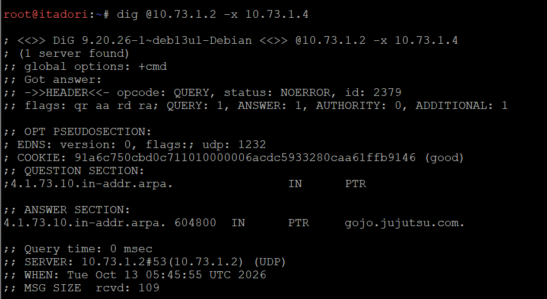
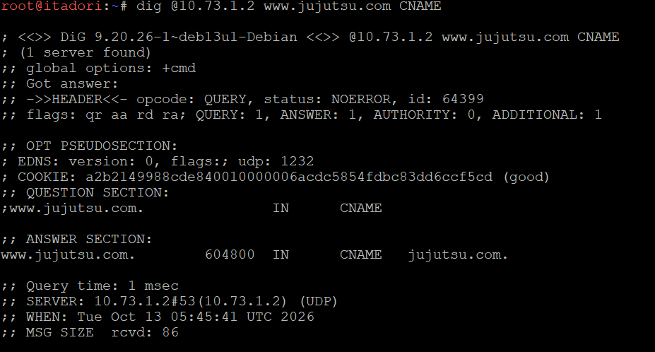
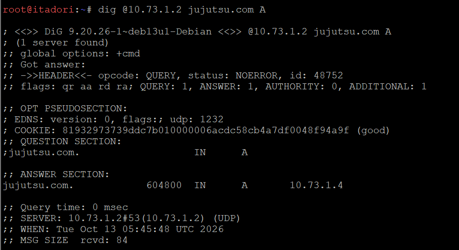
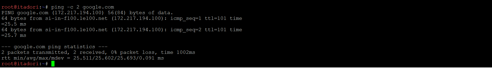

## Soal 13 — Replikasi database MariaDB Master-Slave (Yaga dan Inumaki)

Yaga dikonfigurasi sebagai DB Master dengan binary logging aktif (`server-id`, `log_bin`) dan `bind-address` 0.0.0.0. Pada Yaga dibuat database `db_shibuya_jujutsu`, tabel `request_logs`, user replikasi `repl`, serta user remote `admin_net4` untuk seluruh node di Network 4. Inumaki dikonfigurasi sebagai DB Slave dengan `server-id` berbeda, mengambil dump beserta posisi binlog langsung dari Yaga, lalu dihubungkan ke Master dengan `CHANGE MASTER TO`. Replikasi dibuktikan dengan memasukkan data baru di Master dan memeriksa hasilnya di Slave.

**Yaga — konfigurasi Master, database, tabel, dan user**

```bash
DB="db_shibuya_jujutsu"

# 1. Jalur ke Jichi & DNS (supaya apt-get bisa jalan)
ip route add default via 10.73.4.1 2>/dev/null
echo "nameserver 8.8.8.8" > /etc/resolv.conf
ping -c 2 8.8.8.8 || { echo "GAGAL: tidak ada internet, cek script Jichi"; exit 1; }

# 2. Install MariaDB (ini yang membuat user mysql ada)
export DEBIAN_FRONTEND=noninteractive
apt-get update
apt-get install -y mariadb-server mariadb-client

# 3. Konfigurasi Master (server-id, binary log, bind-address)
mkdir -p /var/log/mysql
chown mysql:mysql /var/log/mysql

cat << EOF > /etc/mysql/mariadb.conf.d/50-server.cnf
[mysqld]
user                    = mysql
pid-file                = /run/mysqld/mysqld.pid
basedir                 = /usr
datadir                 = /var/lib/mysql
tmpdir                  = /tmp
lc-messages-dir         = /usr/share/mysql
bind-address            = 0.0.0.0

server-id               = 1
log_bin                 = /var/log/mysql/mysql-bin.log
binlog_do_db            = $DB
EOF

# 4. Restart service supaya server-id & log_bin aktif
service mariadb restart || service mariadb start
sleep 3
mysql -u root -e "SELECT @@server_id, @@log_bin;"

# 5. Buat Database, Tabel, User Replikasi & User Remote Network 4
mysql -u root << EOF
CREATE DATABASE IF NOT EXISTS $DB;
USE $DB;
CREATE TABLE IF NOT EXISTS request_logs (
    id INT AUTO_INCREMENT PRIMARY KEY,
    activity VARCHAR(255) NOT NULL,
    created_at TIMESTAMP DEFAULT CURRENT_TIMESTAMP
);

CREATE USER IF NOT EXISTS 'repl'@'%' IDENTIFIED BY 'password123';
GRANT REPLICATION SLAVE ON *.* TO 'repl'@'%';

CREATE USER IF NOT EXISTS 'admin_net4'@'10.73.4.%' IDENTIFIED BY 'password123';
GRANT ALL PRIVILEGES ON $DB.* TO 'admin_net4'@'10.73.4.%';
GRANT SELECT, SHOW VIEW, TRIGGER, EVENT, LOCK TABLES, RELOAD, BINLOG MONITOR ON *.* TO 'admin_net4'@'10.73.4.%';
FLUSH PRIVILEGES;
EOF

# 6. Tampilkan status master
mysql -u root -e "SHOW MASTER STATUS;"
mysql -u root -e "SELECT user,host FROM mysql.user WHERE user IN ('repl','admin_net4');"
ss -tlnp | grep 3306
```


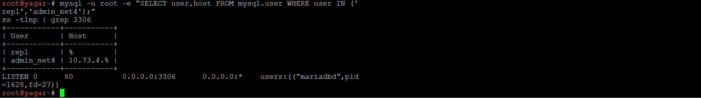

**Inumaki — konfigurasi Slave dan penghubungan ke Master**

```bash
DB="db_shibuya_jujutsu"

# 1. Jalur ke Jichi & DNS (supaya apt-get bisa jalan)
ip route add default via 10.73.4.1 2>/dev/null
echo "nameserver 8.8.8.8" > /etc/resolv.conf
ping -c 2 8.8.8.8 || { echo "GAGAL: tidak ada internet, cek script Jichi"; exit 1; }

# 2. Install MariaDB
export DEBIAN_FRONTEND=noninteractive
apt-get update
apt-get install -y mariadb-server mariadb-client

# 3. Konfigurasi Slave (server-id=2)
printf "[mysqld]\nserver-id = 2\n" > /etc/mysql/mariadb.conf.d/99-slave.cnf

# 4. Restart service supaya server-id aktif
service mariadb restart || service mariadb start
sleep 3
mysql -u root -e "SELECT @@server_id;"

# 5. Uji akses remote Network 4 ke Yaga (user admin_net4)
mysql -h 10.73.4.9 -u admin_net4 -ppassword123 -e "SELECT USER(), CURRENT_USER();" || { echo "GAGAL: tidak bisa login ke Yaga, jalankan script Yaga dulu"; exit 1; }

# 6. Ambil dump + posisi binlog langsung dari Yaga
mysqldump -h 10.73.4.9 -u admin_net4 -ppassword123 --databases $DB --single-transaction --master-data=2 > /tmp/dump.sql
[ -s /tmp/dump.sql ] || { echo "GAGAL: dump kosong"; exit 1; }

# 7. Reset slave lama & import dump
mysql -u root -e "STOP SLAVE; RESET SLAVE ALL;"
mysql -u root < /tmp/dump.sql

# 8. Ambil nama file & posisi binlog otomatis dari dump
LOG_FILE=$(grep -o "MASTER_LOG_FILE='[^']*'" /tmp/dump.sql | cut -d"'" -f2)
LOG_POS=$(grep -o "MASTER_LOG_POS=[0-9]*" /tmp/dump.sql | cut -d= -f2)
echo "Master File: $LOG_FILE | Position: $LOG_POS"

# 9. Hubungkan Slave ke Master (Yaga) & start replikasi
mysql -u root << EOF
CHANGE MASTER TO
  MASTER_HOST='10.73.4.9',
  MASTER_USER='repl',
  MASTER_PASSWORD='password123',
  MASTER_LOG_FILE='$LOG_FILE',
  MASTER_LOG_POS=$LOG_POS;
START SLAVE;
EOF

# 10. Tampilkan status slave
sleep 2
mysql -u root -e "SHOW SLAVE STATUS\G" | grep -E "Master_Host|Master_Log_File|Slave_IO_Running|Slave_SQL_Running|Error"
```

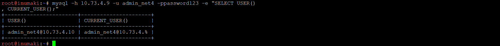


**Yaga dan Inumaki — pembuktian replikasi**

```bash
DB="db_shibuya_jujutsu"

# [Di Yaga] 1. Insert data baru ke Master
mysql -u root -e "USE $DB; INSERT INTO request_logs (activity) VALUES ('TEST REPLIKASI OK');"

# [Di Yaga] 2. Lihat data di Master
mysql -u root -e "USE $DB; SELECT * FROM request_logs;"

# [Di Inumaki] 3. Data harus muncul otomatis di Slave
mysql -u root -e "USE $DB; SELECT * FROM request_logs;"
```


## Soal 14 — Web worker, API worker, dan pembatasan akses lewat proxy

Maki dan Panda dipasang Nginx dan PHP-FPM sebagai web worker yang menampilkan hostname masing-masing. Nanami, Todo, dan Kirara dipasang Nginx dan PHP-FPM sebagai API worker yang mencatat setiap request ke tabel `request_logs` di database Yaga. Virtual host dikonfigurasi agar worker merespons domain layanan, dan akses dibatasi dengan `allow`/`deny`. Web worker hanya menerima trafik dari proxy web (Gojo, `10.73.1.4`), sedangkan API worker hanya menerima trafik dari Geto (`10.73.4.2`). Geto dan Gojo dikonfigurasi sebagai reverse proxy. Pengujian membuktikan bahwa akses langsung dari klien ditolak (403), sementara akses melalui proxy berhasil.

**Maki dan Panda — web worker**

```bash
PROXY_WEB_IP="10.73.1.4"       # IP proxy web (Gojo)
DOMAIN_WEB="ISI_DOMAIN_WEB"    # Domain web dari soal

# 1. Jalur ke Jichi & DNS
ip route add default via 10.73.4.1 2>/dev/null
echo "nameserver 8.8.8.8" > /etc/resolv.conf
ping -c 2 8.8.8.8 || { echo "GAGAL: tidak ada internet, cek script Jichi"; exit 1; }

# 2. Install Nginx + PHP-FPM
export DEBIAN_FRONTEND=noninteractive
apt-get update
apt-get install -y nginx php-fpm curl

# 3. Jalankan PHP-FPM & cari socket-nya
PHPV=$(ls /etc/php | head -1)
service php$PHPV-fpm restart || service php$PHPV-fpm start
sleep 2
SOCK=$(ls /run/php/php*-fpm.sock | head -1)
echo "PHP-FPM socket: $SOCK"

# 4. Halaman web: tampilkan hostname
mkdir -p /var/www/web
cat << 'ENDPHP' > /var/www/web/index.php
<?php
echo "<h1>Web Worker</h1>";
echo "<p>Hostname: " . gethostname() . "</p>";
echo "<p>Client (di mata worker): " . $_SERVER['REMOTE_ADDR'] . "</p>";
ENDPHP
chown -R www-data:www-data /var/www/web

# 5. Virtual host + hanya menerima trafik dari proxy web
rm -f /etc/nginx/sites-enabled/default /etc/nginx/sites-enabled/web /etc/nginx/sites-enabled/api
cat << ENDCONF > /etc/nginx/sites-available/web
server {
    listen 80 default_server;
    server_name $DOMAIN_WEB;
    root /var/www/web;
    index index.php;

    allow $PROXY_WEB_IP;
    deny all;

    location / {
        try_files \$uri \$uri/ =404;
    }
    location ~ \.php\$ {
        include snippets/fastcgi-php.conf;
        fastcgi_pass unix:$SOCK;
    }
}
ENDCONF
ln -sf /etc/nginx/sites-available/web /etc/nginx/sites-enabled/web

# 6. Cek sintaks & restart Nginx
nginx -t && (service nginx restart || service nginx start)

# 7. Tes lokal (harus 403 karena 127.0.0.1 bukan IP proxy)
curl -s -o /dev/null -w "lokal (harus 403): %{http_code}\n" http://127.0.0.1/
```

**Gojo — uji web worker dari IP proxy yang diizinkan**

```bash
curl -H "Host: DOMAIN_WEB" http://10.73.4.3/
curl -H "Host: DOMAIN_WEB" http://10.73.4.4/
```


**Nanami, Todo, dan Kirara — API worker**

```bash
GETO_IP="10.73.4.2"            # Hanya Geto yang boleh akses
DOMAIN_API="ISI_DOMAIN_API"    # Domain API dari soal
DB="db_shibuya_jujutsu"

# 1. Jalur ke Jichi & DNS
ip route add default via 10.73.4.1 2>/dev/null
echo "nameserver 8.8.8.8" > /etc/resolv.conf
ping -c 2 8.8.8.8 || { echo "GAGAL: tidak ada internet, cek script Jichi"; exit 1; }

# 2. Install Nginx + PHP-FPM + driver MySQL + client
export DEBIAN_FRONTEND=noninteractive
apt-get update
apt-get install -y nginx php-fpm php-mysql curl mariadb-client

PHPV=$(ls /etc/php | head -1)
service php$PHPV-fpm restart || service php$PHPV-fpm start
sleep 2
SOCK=$(ls /run/php/php*-fpm.sock | head -1)
echo "PHP-FPM socket: $SOCK"

# 3. Tes koneksi ke database Yaga (script Yaga harus sudah dijalankan)
mysql -h 10.73.4.9 -u admin_net4 -ppassword123 -e "SELECT 1;" || { echo "GAGAL: tidak bisa login ke Yaga"; exit 1; }

# 4. API: catat setiap request ke tabel request_logs di Yaga
mkdir -p /var/www/api
cat << ENDPHP > /var/www/api/index.php
<?php
header('Content-Type: application/json');
mysqli_report(MYSQLI_REPORT_OFF);
\$db = @new mysqli('10.73.4.9', 'admin_net4', 'password123', '$DB');
if (\$db->connect_errno) {
    http_response_code(500);
    echo json_encode(['status' => 'error', 'msg' => \$db->connect_error]);
    exit;
}
\$activity = 'API ' . gethostname() . ' ' . \$_SERVER['REQUEST_METHOD'] . ' ' . \$_SERVER['REQUEST_URI'];
\$stmt = \$db->prepare('INSERT INTO request_logs (activity) VALUES (?)');
\$stmt->bind_param('s', \$activity);
\$stmt->execute();
echo json_encode(['status' => 'ok', 'worker' => gethostname(), 'logged' => \$activity]);
ENDPHP
chown -R www-data:www-data /var/www/api

# 5. Virtual host + hanya menerima trafik dari Geto
rm -f /etc/nginx/sites-enabled/default /etc/nginx/sites-enabled/web /etc/nginx/sites-enabled/api
cat << ENDCONF > /etc/nginx/sites-available/api
server {
    listen 80 default_server;
    server_name $DOMAIN_API;
    root /var/www/api;
    index index.php;

    allow $GETO_IP;
    deny all;

    location / {
        try_files \$uri /index.php\$is_args\$args;
    }
    location ~ \.php\$ {
        include snippets/fastcgi-php.conf;
        fastcgi_pass unix:$SOCK;
    }
}
ENDCONF
ln -sf /etc/nginx/sites-available/api /etc/nginx/sites-enabled/api

# 6. Cek sintaks & restart Nginx
nginx -t && (service nginx restart || service nginx start)

# 7. Tes lokal (harus 403 karena 127.0.0.1 bukan Geto)
curl -s -o /dev/null -w "lokal (harus 403): %{http_code}\n" http://127.0.0.1/
```

**Geto — uji API worker dari IP proxy yang diizinkan**

```bash
curl -H "Host: DOMAIN_API" http://10.73.4.5/
curl -H "Host: DOMAIN_API" http://10.73.4.6/
curl -H "Host: DOMAIN_API" http://10.73.4.7/
```

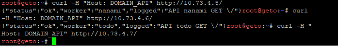

**Geto — proxy API**

```bash
DOMAIN_API="ISI_DOMAIN_API"    # Sama dengan di API worker

# 1. Jalur ke Jichi & DNS
ip route add default via 10.73.4.1 2>/dev/null
echo "nameserver 8.8.8.8" > /etc/resolv.conf
ping -c 2 8.8.8.8 || { echo "GAGAL: tidak ada internet, cek script Jichi"; exit 1; }

# 2. Install Nginx
export DEBIAN_FRONTEND=noninteractive
apt-get update
apt-get install -y nginx curl

# 3. Reverse proxy ke 3 API worker (Nanami, Todo, Kirara)
rm -f /etc/nginx/sites-enabled/default
cat << ENDCONF > /etc/nginx/sites-available/proxy-api
upstream api_workers {
    server 10.73.4.5;
    server 10.73.4.6;
    server 10.73.4.7;
}
server {
    listen 80 default_server;
    server_name $DOMAIN_API;

    location / {
        proxy_pass http://api_workers;
        proxy_set_header Host \$host;
        proxy_set_header X-Real-IP \$remote_addr;
    }
}
ENDCONF
ln -sf /etc/nginx/sites-available/proxy-api /etc/nginx/sites-enabled/proxy-api

nginx -t && (service nginx restart || service nginx start)

# 4. Tes lewat proxy sendiri (harus bergantian antar worker)
for i in 1 2 3; do curl -s -H "Host: $DOMAIN_API" http://127.0.0.1/; echo; done
```

```bash
curl -i -H "Host: DOMAIN_API" http://127.0.0.1/
```

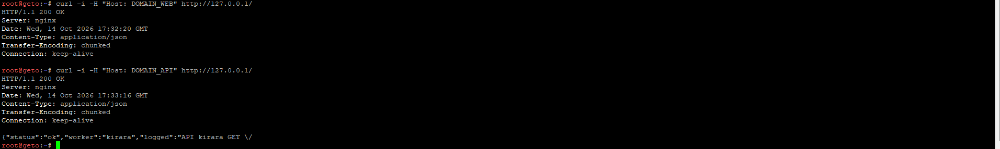

**Gojo — proxy web**

```bash
DOMAIN_WEB="ISI_DOMAIN_WEB"    # Sama dengan di Maki & Panda

# 1. Jalur ke Jichi & DNS
ip route add default via 10.73.1.1 2>/dev/null
echo "nameserver 8.8.8.8" > /etc/resolv.conf
ping -c 2 8.8.8.8 || { echo "GAGAL: tidak ada internet, cek script Jichi"; exit 1; }

# 2. Install Nginx
export DEBIAN_FRONTEND=noninteractive
apt-get update
apt-get install -y nginx curl

# 3. Reverse proxy ke Maki & Panda
rm -f /etc/nginx/sites-enabled/default
cat << ENDCONF > /etc/nginx/sites-available/proxy-web
upstream web_workers {
    server 10.73.4.3;
    server 10.73.4.4;
}
server {
    listen 80 default_server;
    server_name $DOMAIN_WEB;

    location / {
        proxy_pass http://web_workers;
        proxy_set_header Host \$host;
        proxy_set_header X-Real-IP \$remote_addr;
    }
}
ENDCONF
ln -sf /etc/nginx/sites-available/proxy-web /etc/nginx/sites-enabled/proxy-web

nginx -t && (service nginx restart || service nginx start)

# 4. Tes lewat proxy sendiri (hostname Maki/Panda harus bergantian)
for i in 1 2 3 4; do curl -s -H "Host: $DOMAIN_WEB" http://127.0.0.1/ | grep Hostname; done
```

```bash
curl -i -H "Host: DOMAIN_WEB" http://127.0.0.1/
```

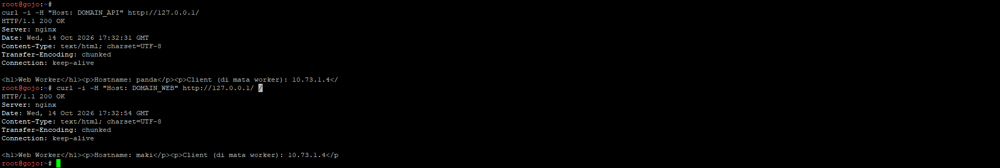

**Itadori — akses langsung ke worker harus ditolak**

```bash
curl -i http://10.73.4.3/
curl -i http://10.73.4.4/
curl -i http://10.73.4.5/
curl -i http://10.73.4.6/
curl -i http://10.73.4.7/
```

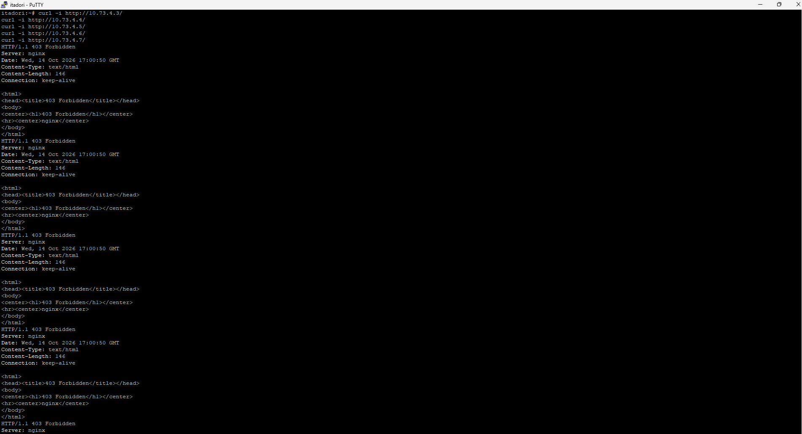

**Itadori — akses melalui proxy berhasil**

```bash
curl -i -H "Host: DOMAIN_WEB" http://10.73.1.4/
```

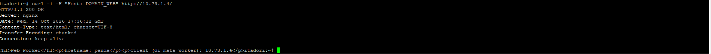

**Yaga — bukti log tercatat**

```bash
mysql -u root -e "USE db_shibuya_jujutsu; SELECT * FROM request_logs ORDER BY id DESC LIMIT 5;"
```

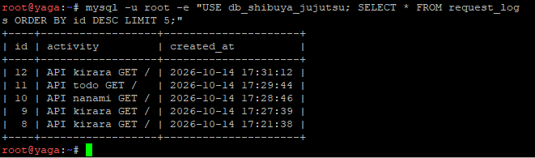

## Soal 15 — Load Balancer API dengan Weighted Round Robin 3:1

Geto dikonfigurasi sebagai load balancer internal untuk layanan API menggunakan upstream `api_cluster` dengan metode Weighted Round Robin. Nanami diberi bobot 3 dan Todo bobot 1, sehingga Nanami menerima beban tiga kali lebih banyak. Kirara tidak dimasukkan ke upstream pada soal ini. Pembuktian dilakukan dari Maki (Network 4, jaringan lokal Data Center) dengan mengirim 40 request berulang ke Geto, lalu menghitung jumlah respons tiap worker. Hasilnya dicocokkan dengan isi tabel `request_logs` di Yaga.

**Geto — konfigurasi upstream api_cluster**

```bash
DOMAIN_API="ISI_DOMAIN_API"    # Sama dengan domain API di soal 14

# Upstream api_cluster: Weighted Round Robin 3:1 (Kirara tidak dipakai)
rm -f /etc/nginx/sites-enabled/default
cat << ENDCONF > /etc/nginx/sites-available/proxy-api
upstream api_cluster {
    server 10.73.4.5 weight=3;    # Nanami
    server 10.73.4.6 weight=1;    # Todo
}
server {
    listen 80 default_server;
    server_name $DOMAIN_API;

    location / {
        proxy_pass http://api_cluster;
        proxy_set_header Host \$host;
        proxy_set_header X-Real-IP \$remote_addr;
    }
}
ENDCONF
ln -sf /etc/nginx/sites-available/proxy-api /etc/nginx/sites-enabled/proxy-api

# Cek sintaks dulu, baru reload
nginx -t && (service nginx reload || service nginx restart)

# Tampilkan konfigurasi
cat /etc/nginx/sites-available/proxy-api
```

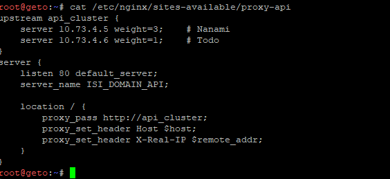
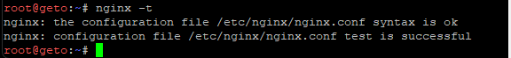

**Yaga — kosongkan log sebelum pengujian**

```bash
mysql -u root -e "TRUNCATE db_shibuya_jujutsu.request_logs;"
```

**Maki — kirim 40 request dan hitung distribusi**

```bash
DOMAIN_API="ISI_DOMAIN_API"    # Sama dengan domain API di Geto
GETO_IP="10.73.4.2"

# Kirim 40 request ke Geto, simpan hasil mentah
rm -f hasil.txt
for i in $(seq 1 40); do
  curl -s -H "Host: $DOMAIN_API" "http://$GETO_IP/" >> hasil.txt
  echo >> hasil.txt
done

# Tampilkan sebagian hasil untuk membuktikan worker bergantian
head -12 hasil.txt
```

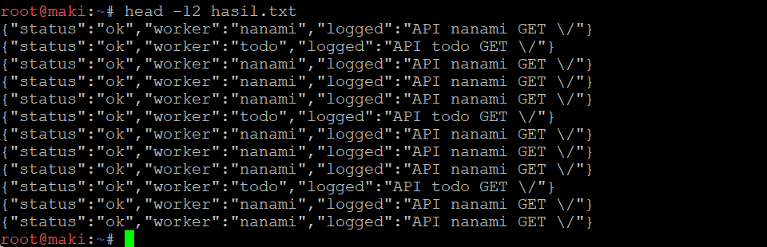

```bash
# Hitung request per worker
echo "=== Hitungan per worker ==="
grep -o '"worker":"[^"]*"' hasil.txt | sort | uniq -c

# Rasio Nanami : Todo
N=$(grep -c '"worker":"nanami"' hasil.txt)
T=$(grep -c '"worker":"todo"' hasil.txt)
echo "Nanami = $N, Todo = $T"
echo "Rasio Nanami : Todo = $N : $T (target 3 : 1)"
```


**Yaga — bukti tambahan dari database**

```bash
mysql -u root -e "SELECT activity, COUNT(*) AS jumlah FROM db_shibuya_jujutsu.request_logs GROUP BY activity;"
```


## Soal 16 — Gateway publik Gojo dengan Path-Based Routing

Gojo dikonfigurasi sebagai gerbang publik tunggal yang melayani domain `jujutsu.com` dan `www.jujutsu.com` dengan Path-Based Routing. Request ke path `/` diteruskan secara Round Robin ke worker frontend (Maki dan Panda), sedangkan request ke path `/api` diteruskan ke Geto, yang membaginya ke Nanami dan Todo dengan bobot 3:1 (soal 15). Header `Host`, `X-Real-IP`, dan `X-Forwarded-For` ikut diteruskan. Pengujian dilakukan dari Itadori (Network 2, klien Divisi A atau B).

**Gojo — konfigurasi gateway path-based**

```bash
DOMAIN="jujutsu.com"    # ganti sesuai <xxxx> di soal, mis. jujutsu.k19.com

# 1. Jalur ke Jichi & DNS
ip route add default via 10.73.1.1 2>/dev/null
echo "nameserver 8.8.8.8" > /etc/resolv.conf
ping -c 2 8.8.8.8 || { echo "GAGAL: tidak ada internet, cek script Jichi"; exit 1; }

# 2. Install Nginx
export DEBIAN_FRONTEND=noninteractive
apt-get update
apt-get install -y nginx curl

# 3. Virtual host path-based
rm -f /etc/nginx/sites-enabled/default /etc/nginx/sites-enabled/proxy-web /etc/nginx/sites-enabled/gateway
cat << ENDCONF > /etc/nginx/sites-available/gateway
upstream web_cluster {
    server 10.73.4.3;    # maki
    server 10.73.4.4;    # panda
}

server {
    listen 80 default_server;
    server_name $DOMAIN www.$DOMAIN;

    location / {
        proxy_pass http://web_cluster;
        proxy_set_header Host \$host;
        proxy_set_header X-Real-IP \$remote_addr;
        proxy_set_header X-Forwarded-For \$proxy_add_x_forwarded_for;
    }

    location /api {
        proxy_pass http://10.73.4.2;
        proxy_set_header Host \$host;
        proxy_set_header X-Real-IP \$remote_addr;
        proxy_set_header X-Forwarded-For \$proxy_add_x_forwarded_for;
    }
}
ENDCONF
ln -sf /etc/nginx/sites-available/gateway /etc/nginx/sites-enabled/gateway

# 4. Cek sintaks & restart
nginx -t && (service nginx restart || service nginx start)

# 5. Tes dari Gojo sendiri
for i in 1 2 3 4; do curl -s -H "Host: $DOMAIN" http://127.0.0.1/ | grep Hostname; done
for i in 1 2 3 4; do curl -s -H "Host: $DOMAIN" http://127.0.0.1/api; echo; done
```

**Itadori — uji akses web utama, domain www, dan path /api**

```bash
# 1. Pastikan DNS & route
echo "nameserver 10.73.1.2" > /etc/resolv.conf
ip route add default via 10.73.2.1 2>/dev/null

# 2. Web utama: dibalas Maki/Panda bergantian
curl -s http://jujutsu.com/ | grep Hostname

# 3. Domain www
curl -s http://www.jujutsu.com/ | grep Hostname

# 4. Path /api: dibalas Nanami/Todo
for i in 1 2 3 4 5 6 7 8; do curl -s http://jujutsu.com/api; echo; done
```


## Soal 17 — Meneruskan IP klien asli (X-Real-IP dan X-Forwarded-For)

Gojo dan Geto dikonfigurasi agar meneruskan alamat klien melalui header `X-Real-IP` dan `X-Forwarded-For`. Gojo sebagai gerbang paling luar menimpa `X-Forwarded-For` dengan `$remote_addr`, sehingga header kiriman klien tidak dipercaya. Geto hanya mempercayai header dari proxy terpercaya (Gojo, `10.73.1.4`) lewat `set_real_ip_from`. Skrip API di worker hanya memakai `X-Real-IP` bila pengirim langsungnya Geto, memvalidasi formatnya, lalu menyimpannya ke kolom `client_ip` pada tabel `request_logs` di Yaga. Pengujian dilakukan dari Itadori (Network 2) dan Ino (Network 3), lalu database diperiksa untuk memastikan yang tercatat adalah IP klien asal, bukan IP Gojo atau Geto.

**Yaga — tambah kolom client_ip**

```bash
DB="db_shibuya_jujutsu"

# Pakai USE supaya tercatat di binlog dan terreplikasi ke Inumaki
mysql -u root -e "USE $DB; ALTER TABLE request_logs ADD COLUMN IF NOT EXISTS client_ip VARCHAR(45) NULL;"
mysql -u root -e "USE $DB; DESCRIBE request_logs;"
```


**Nanami, Todo, dan Kirara — skrip API menyimpan client_ip**

```bash
cat << 'ENDPHP' > /var/www/api/index.php
<?php
header('Content-Type: application/json');
mysqli_report(MYSQLI_REPORT_OFF);

// Percaya X-Real-IP hanya jika pengirim langsung adalah Geto
$trusted_proxy = '10.73.4.2';
$client_ip = $_SERVER['REMOTE_ADDR'];
if ($_SERVER['REMOTE_ADDR'] === $trusted_proxy && !empty($_SERVER['HTTP_X_REAL_IP'])) {
    $candidate = trim($_SERVER['HTTP_X_REAL_IP']);
    if (filter_var($candidate, FILTER_VALIDATE_IP)) {
        $client_ip = $candidate;
    }
}

$db = @new mysqli('10.73.4.9', 'admin_net4', 'password123', 'db_shibuya_jujutsu');
if ($db->connect_errno) {
    http_response_code(500);
    echo json_encode(['status' => 'error', 'msg' => $db->connect_error]);
    exit;
}

$activity = 'API ' . gethostname() . ' ' . $_SERVER['REQUEST_METHOD'] . ' ' . $_SERVER['REQUEST_URI'];
$stmt = $db->prepare('INSERT INTO request_logs (activity, client_ip) VALUES (?, ?)');
$stmt->bind_param('ss', $activity, $client_ip);
$stmt->execute();

echo json_encode([
    'status' => 'ok',
    'worker' => gethostname(),
    'client_ip' => $client_ip,
    'logged' => $activity
]);
ENDPHP
chown www-data:www-data /var/www/api/index.php

grep -c client_ip /var/www/api/index.php
curl -s -o /dev/null -w "lokal (harus 403): %{http_code}\n" http://127.0.0.1/
```

**Geto — load balancer dengan trusted proxy**

```bash
rm -f /etc/nginx/sites-enabled/default /etc/nginx/sites-enabled/proxy-api /etc/nginx/sites-enabled/api-lb
rm -f /etc/nginx/sites-available/proxy-api

cat << 'ENDCONF' > /etc/nginx/sites-available/api-lb
upstream api_cluster {
    server 10.73.4.5 weight=3;    # nanami
    server 10.73.4.6 weight=1;    # todo
}

server {
    listen 80 default_server;
    server_name _;

    # Hanya header dari Gojo yang dipercaya
    set_real_ip_from 10.73.1.4;
    real_ip_header X-Forwarded-For;
    real_ip_recursive on;

    location / {
        proxy_pass http://api_cluster;
        proxy_set_header Host $host;
        proxy_set_header X-Real-IP $remote_addr;
        proxy_set_header X-Forwarded-For $http_x_forwarded_for;
    }
}
ENDCONF
ln -sf /etc/nginx/sites-available/api-lb /etc/nginx/sites-enabled/api-lb

nginx -t && (service nginx restart || service nginx start)
```


**Gojo — gateway meneruskan X-Real-IP dan X-Forwarded-For**

```bash
DOMAIN="jujutsu.com"    # ganti sesuai <xxxx> di soal

rm -f /etc/nginx/sites-enabled/default /etc/nginx/sites-enabled/gateway
cat << 'ENDCONF' > /etc/nginx/sites-available/gateway
upstream web_cluster {
    server 10.73.4.3;    # maki
    server 10.73.4.4;    # panda
}

server {
    listen 80 default_server;
    server_name __DOMAIN__ www.__DOMAIN__;

    location / {
        proxy_pass http://web_cluster;
        proxy_set_header Host $host;
        proxy_set_header X-Real-IP $remote_addr;
        proxy_set_header X-Forwarded-For $remote_addr;
    }

    location /api {
        proxy_pass http://10.73.4.2;
        proxy_set_header Host $host;
        proxy_set_header X-Real-IP $remote_addr;
        proxy_set_header X-Forwarded-For $remote_addr;
    }
}
ENDCONF
sed -i "s/__DOMAIN__/$DOMAIN/g" /etc/nginx/sites-available/gateway
ln -sf /etc/nginx/sites-available/gateway /etc/nginx/sites-enabled/gateway

nginx -t && (service nginx restart || service nginx start)
grep -n "X-Forwarded-For\|X-Real-IP" /etc/nginx/sites-available/gateway
```


**Itadori — uji dari klien Network 2**

```bash
echo "nameserver 10.73.1.2" > /etc/resolv.conf
ip -4 a show eth0
for i in 1 2 3 4 5 6 7 8; do curl -s http://jujutsu.com/api; echo; done
```


**Ino — uji dari klien Network 3**

```bash
hostname
ip -4 a show eth0
echo "nameserver 10.73.1.2" > /etc/resolv.conf
ip route add default via 10.73.3.1 2>/dev/null
for i in 1 2 3 4 5 6 7 8; do curl -s http://jujutsu.com/api; echo; done
```


**Yaga — bukti alamat klien di database**

```bash
mysql -u root -e "USE db_shibuya_jujutsu; SELECT id, activity, client_ip FROM request_logs WHERE client_ip LIKE '10.73.2.%' OR client_ip LIKE '10.73.3.%' ORDER BY id DESC LIMIT 12;"
```


## Soal 18 — Kirara sebagai server backup dan passive health check

Nanami dan Todo berperan sebagai worker API utama, sedangkan Kirara disiapkan sebagai worker cadangan. Kirara menjalankan API yang sama dengan worker utama (versi soal 17, menyimpan `client_ip`) dan hanya menerima trafik dari Geto. Pada Geto, upstream `api_cluster` diubah: Kirara ditandai `backup`, dan worker utama diberi passive health check `max_fails=2` dengan `fail_timeout=5s`. Directive `proxy_next_upstream` memastikan request yang gagal dialihkan ke server berikutnya tanpa error 502. Gangguan disimulasikan dengan menghentikan Nginx pada Nanami dan Todo, lalu dibuktikan dari Itadori bahwa request `/api` tetap berhasil dan dijawab Kirara.

**Kirara — API worker cadangan**

```bash
GETO_IP="10.73.4.2"

# 1. Jalur ke Jichi & DNS
ip route add default via 10.73.4.1 2>/dev/null
echo "nameserver 8.8.8.8" > /etc/resolv.conf
ping -c 2 8.8.8.8 || { echo "GAGAL: tidak ada internet, cek script Jichi"; exit 1; }

# 2. Install Nginx + PHP-FPM + driver MySQL + client
export DEBIAN_FRONTEND=noninteractive
apt-get update
apt-get install -y nginx php-fpm php-mysql curl mariadb-client

PHPV=$(ls /etc/php | head -1)
service php$PHPV-fpm restart || service php$PHPV-fpm start
sleep 2
SOCK=$(ls /run/php/php*-fpm.sock | head -1)

# 3. Tes koneksi ke Yaga
mysql -h 10.73.4.9 -u admin_net4 -ppassword123 -e "SELECT 1;" || { echo "GAGAL: tidak bisa login ke Yaga"; exit 1; }

# 4. API sama dengan Nanami/Todo (versi soal 17, ada client_ip)
mkdir -p /var/www/api
cat << 'ENDPHP' > /var/www/api/index.php
<?php
header('Content-Type: application/json');
mysqli_report(MYSQLI_REPORT_OFF);

$trusted_proxy = '10.73.4.2';
$client_ip = $_SERVER['REMOTE_ADDR'];
if ($_SERVER['REMOTE_ADDR'] === $trusted_proxy && !empty($_SERVER['HTTP_X_REAL_IP'])) {
    $candidate = trim($_SERVER['HTTP_X_REAL_IP']);
    if (filter_var($candidate, FILTER_VALIDATE_IP)) {
        $client_ip = $candidate;
    }
}

$db = @new mysqli('10.73.4.9', 'admin_net4', 'password123', 'db_shibuya_jujutsu');
if ($db->connect_errno) {
    http_response_code(500);
    echo json_encode(['status' => 'error', 'msg' => $db->connect_error]);
    exit;
}

$activity = 'API ' . gethostname() . ' ' . $_SERVER['REQUEST_METHOD'] . ' ' . $_SERVER['REQUEST_URI'];
$stmt = $db->prepare('INSERT INTO request_logs (activity, client_ip) VALUES (?, ?)');
$stmt->bind_param('ss', $activity, $client_ip);
$stmt->execute();

echo json_encode([
    'status' => 'ok',
    'worker' => gethostname(),
    'client_ip' => $client_ip,
    'logged' => $activity
]);
ENDPHP
chown -R www-data:www-data /var/www/api

# 5. Virtual host, hanya menerima Geto
rm -f /etc/nginx/sites-enabled/default /etc/nginx/sites-enabled/web /etc/nginx/sites-enabled/api
cat << ENDCONF > /etc/nginx/sites-available/api
server {
    listen 80 default_server;
    server_name _;
    root /var/www/api;
    index index.php;

    allow $GETO_IP;
    deny all;

    location / {
        try_files \$uri /index.php\$is_args\$args;
    }
    location ~ \.php\$ {
        include snippets/fastcgi-php.conf;
        fastcgi_pass unix:$SOCK;
    }
}
ENDCONF
ln -sf /etc/nginx/sites-available/api /etc/nginx/sites-enabled/api

# 6. Cek sintaks & restart
nginx -t && (service nginx restart || service nginx start)

# 7. Tes lokal (harus 403)
curl -s -o /dev/null -w "lokal (harus 403): %{http_code}\n" http://127.0.0.1/
grep -c client_ip /var/www/api/index.php
```

**Geto — upstream dengan backup dan passive health check**

```bash
rm -f /etc/nginx/sites-enabled/default /etc/nginx/sites-enabled/proxy-api /etc/nginx/sites-enabled/api-lb
rm -f /etc/nginx/sites-available/proxy-api

cat << 'ENDCONF' > /etc/nginx/sites-available/api-lb
upstream api_cluster {
    server 10.73.4.5 weight=3 max_fails=2 fail_timeout=5s;
    server 10.73.4.6 weight=1 max_fails=2 fail_timeout=5s;
    server 10.73.4.7 backup;
}

server {
    listen 80 default_server;
    server_name _;

    set_real_ip_from 10.73.1.4;
    real_ip_header X-Forwarded-For;
    real_ip_recursive on;

    location / {
        proxy_pass http://api_cluster;
        proxy_set_header Host $host;
        proxy_set_header X-Real-IP $remote_addr;
        proxy_set_header X-Forwarded-For $http_x_forwarded_for;
        proxy_connect_timeout 2s;
        proxy_next_upstream error timeout http_502 http_503 http_504;
    }
}
ENDCONF
ln -sf /etc/nginx/sites-available/api-lb /etc/nginx/sites-enabled/api-lb

nginx -t && (service nginx restart || service nginx start)
cat /etc/nginx/sites-available/api-lb
```


**Nanami dan Todo — simulasi gangguan**

```bash
service nginx stop
```


**Itadori — request /api dialihkan ke Kirara tanpa error 502**

```bash
echo "nameserver 10.73.1.2" > /etc/resolv.conf

# Semua harus HTTP 200, tidak ada 502
for i in $(seq 1 10); do curl -s -o /dev/null -w "HTTP %{http_code}\n" http://jujutsu.com/api; done

# Respons API valid dari Kirara
for i in $(seq 1 6); do curl -s http://jujutsu.com/api; echo; done

# Hitungan worker (semua kirara)
for i in $(seq 1 10); do curl -s http://jujutsu.com/api; done | grep -o '"worker":"[^"]*"' | sort | uniq -c
```


**Yaga — bukti di database**

```bash
mysql -u root -e "USE db_shibuya_jujutsu; SELECT id, activity, client_ip FROM request_logs ORDER BY id DESC LIMIT 10;"
```


## Soal 19 — Proxy Caching dan Rate Limiting pada Gojo

Gojo dikonfigurasi untuk mengoptimalkan layanan web sekaligus membatasi request berlebihan. Pada path `/` (web frontend) diterapkan Nginx Proxy Caching dengan masa berlaku cache 10 menit untuk respons 200, dan header `X-Cache-Status` ditambahkan agar status cache terlihat. Pada path `/api` diterapkan rate limiting 10 request per detik per IP klien dengan status penolakan 429. Cache dibuktikan dengan status MISS pada akses awal dan HIT pada akses berikutnya. Rate limiting diuji terpisah dengan 30 request beruntun ke `/api`, lalu penolakan dicocokkan dengan error log Gojo.

**Gojo — konfigurasi proxy cache dan rate limit**

```bash
DOMAIN="jujutsu.com"

mkdir -p /var/cache/nginx/web
rm -f /etc/nginx/sites-enabled/default /etc/nginx/sites-enabled/gateway
cat << 'ENDCONF' > /etc/nginx/sites-available/gateway
proxy_cache_path /var/cache/nginx/web levels=1:2 keys_zone=web_cache:10m max_size=100m inactive=10m use_temp_path=off;

limit_req_zone $binary_remote_addr zone=api_limit:10m rate=10r/s;

upstream web_cluster {
    server 10.73.4.3;
    server 10.73.4.4;
}

server {
    listen 80 default_server;
    server_name __DOMAIN__ www.__DOMAIN__;

    location / {
        proxy_cache web_cache;
        proxy_cache_valid 200 10m;
        proxy_ignore_headers Cache-Control Expires Set-Cookie;
        add_header X-Cache-Status $upstream_cache_status always;

        proxy_pass http://web_cluster;
        proxy_set_header Host $host;
        proxy_set_header X-Real-IP $remote_addr;
        proxy_set_header X-Forwarded-For $remote_addr;
    }

    location /api {
        limit_req zone=api_limit;
        limit_req_status 429;

        proxy_pass http://10.73.4.2;
        proxy_set_header Host $host;
        proxy_set_header X-Real-IP $remote_addr;
        proxy_set_header X-Forwarded-For $remote_addr;
    }
}
ENDCONF
sed -i "s/__DOMAIN__/$DOMAIN/g" /etc/nginx/sites-available/gateway
ln -sf /etc/nginx/sites-available/gateway /etc/nginx/sites-enabled/gateway

nginx -t && (service nginx restart || service nginx start)
cat /etc/nginx/sites-available/gateway
```


**Gojo — kosongkan cache sebelum pengujian**

```bash
rm -rf /var/cache/nginx/web/*
```

**Itadori — uji cache: MISS lalu HIT**

```bash
echo "nameserver 10.73.1.2" > /etc/resolv.conf

for i in 1 2 3 4; do
  curl -s -D - -o /dev/null http://jujutsu.com/ | grep -i "X-Cache-Status"
done
```


**Itadori — uji rate limiting: 30 request beruntun ke /api**

```bash
for i in $(seq 1 30); do curl -s -o /dev/null -w "%{http_code}\n" http://jujutsu.com/api; done | sort | uniq -c
```


**Gojo — bukti penolakan pada error log**

```bash
grep "limiting requests" /var/log/nginx/error.log | tail -5
```


